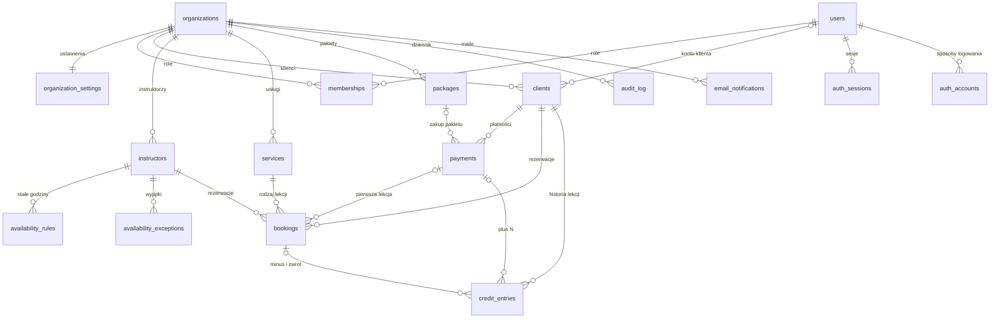

# Model danych

Źródło prawdy: migracje w [`db/migrations`](../db/migrations) — `0001_init.sql` (dane firm), `0002_logowanie.sql` (logowanie) , `0003_ustawienia_grafiku.sql` (flagi `active` godzin pracy i wyjątków, etap 3b) i `0004_maile.sql` (maile z zadań w tle, etap 5b). Reguły z tego dokumentu sprawdzają testy w [`db/tests`](../db/tests) i [`src/lib`](../src/lib).



## Tabele

| Tabela | Co trzyma | Najważniejsze zasady |
|---|---|---|
| `organizations` | firmy (szkoły, trenerzy): nazwa, adres strony (`slug`), strefa czasowa, waluta, konto Stripe | odczyt bez kontekstu, zmiana tylko własnej; nowe zakłada platforma |
| `organization_settings` | reguły grafiku, odwołań, płatności i statusów | jedna linijka na firmę; zakresy wartości pilnowane przez bazę |
| `users` | konto logowania wspólne dla całego systemu; czy e-mail jest potwierdzony | bez RLS; e-mail unikalny bez względu na wielkość liter |
| `auth_sessions` | sesje zalogowanych osób (Better Auth) | globalna, bez RLS; wylogowanie usuwa sesję |
| `auth_accounts` | sposoby logowania, na przyszłość np. konto Google | globalna, bez RLS; teraz pusta, bo logujemy się tylko linkiem z maila |
| `auth_verifications` | jednorazowe tokeny z linków w mailach | globalna, bez RLS; tylko skrót tokenu, nigdy token wprost |
| `memberships` | rola użytkownika w firmie: `owner`, `admin`, `instructor` | użytkownik widzi własne role we wszystkich firmach |
| `clients` | klient firmy (dla szkoły pierwszego tańca: para), status i limit | limit > 0 tylko dla `trusted`; e-mail unikalny w firmie |
| `instructors` | instruktorzy; opcjonalnie konto logowania (`user_id`), z którym instruktor widzi swoje lekcje | wyłączamy (`active`), nie kasujemy; jedno konto to najwyżej jeden instruktor w firmie |
| `availability_rules` | stałe godziny pracy w tygodniu, w czasie lokalnym firmy, od `valid_from` do `valid_to` | 1 = poniedziałek; zmiana „od dnia” kończy stare godziny (`valid_to`), a zastąpione zaplanowane wyłącza (`active`) |
| `availability_exceptions` | urlop, wolne (`unavailable`) albo dodatkowe godziny (`extra`), kto wpisał | czas bezwzględny; odwołany wpis wyłączamy (`active`) |
| `services` | rodzaj lekcji: długość (domyślnie 45 min), ile lekcji zdejmuje, cena pojedynczej | |
| `packages` | pakiety, np. 5 lekcji za 900 zł | |
| `payments` | płatności Stripe i gotówka | gotówka zawsze z osobą, która przyjęła; opłacona zawsze z datą |
| `bookings` | rezerwacje z czasem, statusem i blokadą na czas płatności | **ten sam instruktor nie może mieć nakładających się rezerwacji** |
| `credit_entries` | historia lekcji klienta; saldo = suma | tylko dopisywanie; płatność dopisuje raz, rezerwacja zdejmuje raz i zwraca najwyżej raz |
| `client_balances` (widok) | saldo każdego klienta | podlega RLS czytającego (`security_invoker`) |
| `audit_log` | kto co zrobił (gotówka, zmiana statusu) | tylko dopisywanie |
| `email_notifications` | maile z zadań w tle: przypomnienia o lekcjach i alerty dla szkoły; adresat, stan, liczba prób, ostatni błąd | ten sam mail do tej samej osoby najwyżej raz (unikalny klucz); bez kasowania |

## Rezerwacje i nakładanie się terminów

- Rezerwacja zajmuje przedział `[starts_at, blocks_until)`, gdzie `blocks_until` to koniec lekcji plus przerwa (`buffer_minutes`).
- Przedział jest prawostronnie otwarty, więc 16:00–17:00 i 17:00–18:00 nie kolidują.
- Kalendarz blokują statusy `pending_payment`, `confirmed`, `completed` i `no_show`. Statusy `cancelled`, `late_cancelled` i `expired` zwalniają termin.
- Pilnuje tego ograniczenie `EXCLUDE` w bazie. Działa też wtedy, gdy dwie osoby klikną ten sam termin w tej samej chwili: przechodzi tylko pierwsza, co sprawdza test.
- Blokada na czas płatności wygasa w czasie (`hold_expires_at`), a warunek `EXCLUDE` nie może używać `now()`. Dlatego aplikacja przed wstawieniem rezerwacji zmienia w tej samej transakcji wygasłe blokady na `expired`, a niezależnie od tego robią to co minutę zadania w tle ([`src/lib/background.ts`](../src/lib/background.ts)).

Rezerwacja w aplikacji ([`src/lib/bookings.ts`](../src/lib/bookings.ts), funkcja `bookLesson`) to jedna transakcja:

1. `SELECT … FOR UPDATE` na wierszu klienta. Kolejna rezerwacja tej samej pary czeka na koniec transakcji i widzi już nowe saldo.
2. Wygasłe blokady instruktora (`pending_payment` po `hold_expires_at`) zmieniają się na `expired`.
3. Dla klienta: sprawdzenie, czy termin jest na liście wolnych terminów (`freeSlots` z [`src/lib/slots.ts`](../src/lib/slots.ts)).
4. Sprawdzenie salda: saldo − koszt usługi ≥ −`credit_limit`.
5. Wstawienie rezerwacji (`confirmed`, `blocks_until` = koniec + `buffer_minutes`) i wpisu `booking` w `credit_entries`. Gdy ktoś w tej samej chwili zajął termin, `EXCLUDE` odrzuca rezerwację (kod `23P01`).

Odwołanie (`cancelBooking`) blokuje wiersz rezerwacji, zmienia status na `cancelled` albo `late_cancelled` i przy odwołaniu w terminie dopisuje `booking_refund`.

## Jak aplikacja korzysta z bazy

Aplikacja loguje się rolą `app_user` (`APP_DATABASE_URL`), a dane firmy czyta przez `withTenant()` z [`src/lib/db.ts`](../src/lib/db.ts):

```ts
const clients = await withTenant(db, { organizationId, userId }, (tx) =>
  tx.selectFrom('clients').select(['id', 'displayName']).execute(),
);
```

To samo w SQL:

```sql
BEGIN;
SELECT set_config('app.organization_id', '<uuid firmy>', true),
       set_config('app.user_id', '<uuid użytkownika>', true);
SELECT id, display_name FROM clients;
COMMIT;
```

- Trzeci argument `true` oznacza, że ustawienie znika po transakcji, więc nie przecieka między użytkownikami przy puli połączeń (test: „wybrana firma nie przechodzi na kolejne zapytania z tego samego połączenia”).
- Bez ustawionej firmy zapytania o dane firm zwracają zero wierszy. Z ustawionym tylko użytkownikiem widać jego role i profile klienta we wszystkich firmach — tak powstaje lista firm po zalogowaniu.
- Migracje i dane startowe uruchamia właściciel bazy (`DATABASE_URL`), który nie podlega RLS. Aplikacja nie wystartuje z takim kontem.
