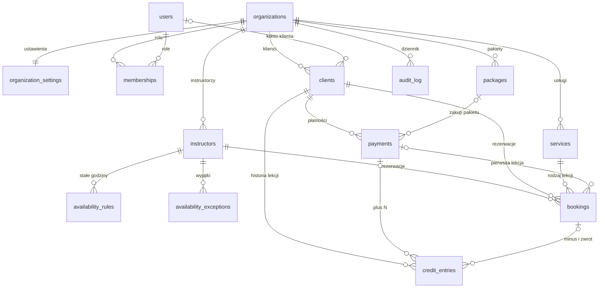

# Model danych

Źródło prawdy: [`db/migrations/0001_init.sql`](../db/migrations/0001_init.sql). Reguły z tego dokumentu sprawdzają testy w [`db/tests`](../db/tests).



## Tabele

| Tabela | Co trzyma | Najważniejsze zasady |
|---|---|---|
| `organizations` | firmy (szkoły, trenerzy): nazwa, adres strony (`slug`), strefa czasowa, waluta, konto Stripe | odczyt bez kontekstu, zmiana tylko własnej; nowe zakłada platforma |
| `organization_settings` | reguły grafiku, odwołań, płatności i statusów | jedna linijka na firmę; zakresy wartości pilnowane przez bazę |
| `users` | konto logowania wspólne dla całego systemu | bez RLS; tabele sesji dojdą z biblioteką logowania |
| `memberships` | rola użytkownika w firmie: `owner`, `admin`, `instructor` | użytkownik widzi własne role we wszystkich firmach |
| `clients` | klient firmy (dla szkoły pierwszego tańca: para), status i limit | limit > 0 tylko dla `trusted`; e-mail unikalny w firmie |
| `instructors` | instruktorzy | wyłączamy (`active`), nie kasujemy |
| `availability_rules` | stałe godziny pracy w tygodniu, w czasie lokalnym firmy | 1 = poniedziałek |
| `availability_exceptions` | urlop, wolne (`unavailable`) albo dodatkowe godziny (`extra`) | czas bezwzględny |
| `services` | rodzaj lekcji: długość (domyślnie 45 min), ile lekcji zdejmuje, cena pojedynczej | |
| `packages` | pakiety, np. 5 lekcji za 900 zł | |
| `payments` | płatności Stripe i gotówka | gotówka zawsze z osobą, która przyjęła; opłacona zawsze z datą |
| `bookings` | rezerwacje z czasem, statusem i blokadą na czas płatności | **ten sam instruktor nie może mieć nakładających się rezerwacji** |
| `credit_entries` | historia lekcji klienta; saldo = suma | tylko dopisywanie; płatność dopisuje raz, rezerwacja zdejmuje raz i zwraca najwyżej raz |
| `client_balances` (widok) | saldo każdego klienta | podlega RLS czytającego (`security_invoker`) |
| `audit_log` | kto co zrobił (gotówka, zmiana statusu) | tylko dopisywanie |

## Rezerwacje i nakładanie się terminów

- Rezerwacja zajmuje przedział `[starts_at, blocks_until)`, gdzie `blocks_until` to koniec lekcji plus przerwa (`buffer_minutes`).
- Przedział jest prawostronnie otwarty, więc 16:00–17:00 i 17:00–18:00 nie kolidują.
- Kalendarz blokują statusy `pending_payment`, `confirmed`, `completed` i `no_show`. Statusy `cancelled`, `late_cancelled` i `expired` zwalniają termin.
- Pilnuje tego ograniczenie `EXCLUDE` w bazie. Działa też wtedy, gdy dwie osoby klikną ten sam termin w tej samej chwili: przechodzi tylko pierwsza, co sprawdza test.
- Blokada na czas płatności wygasa w czasie (`hold_expires_at`), a warunek `EXCLUDE` nie może używać `now()`. Dlatego aplikacja przed wstawieniem rezerwacji zmienia w tej samej transakcji wygasłe blokady na `expired`.

## Jak aplikacja korzysta z bazy

```sql
BEGIN;
SET LOCAL ROLE app_user;                                     -- albo połączenie od razu jako użytkownik z rolą app_user
SELECT set_config('app.organization_id', '<uuid firmy>', true);
SELECT set_config('app.user_id', '<uuid użytkownika>', true);
-- … zapytania tej firmy …
COMMIT;
```

- Trzeci argument `true` oznacza, że ustawienie znika po transakcji, więc nie przecieka między użytkownikami przy puli połączeń.
- Bez ustawionej firmy zapytania o dane firm zwracają zero wierszy.
- Migracje uruchamia rola właściciela bazy, która nie podlega RLS.
